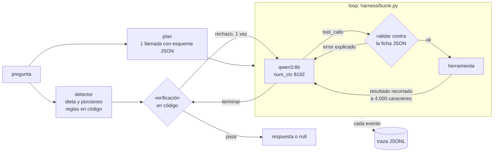

# Rescatá la heladera: informe final

> **Borrador escrito por el asistente de código** a partir de las tablas del notebook 05
> (`resultados/analisis/`), las trazas y `decision_log.md`. Cada número sale de esos archivos. El grupo lo
> revisa, lo corrige y es responsable de cada afirmación; esta nota se borra en la versión que se entrega.

## 1. Problema y brecha

Una persona tiene en la heladera ingredientes con cantidades y fechas de vencimiento, cocina para un número
dado de personas y a veces tiene una dieta (vegetariana, sin lactosa…). Quiere saber **qué receta concreta
puede hacer, qué le falta comprar y en qué cantidad**. Un buscador de recetas no cruza el inventario con las
cantidades escaladas, y un modelo de 8B a libro cerrado inventa recetas y cantidades.

Los datos son *RecetasDeLaAbuela* (SomosNLP, OpenRAIL, commit fijado): 3.184 recetas de recetasgratis.net
con **una sola unidad por ingrediente**, que normalizamos con cada decisión registrada en
`datos/normalizacion/`. La heladera es fija y es estado de la sesión: 10 ingredientes, con el pollo (2 días)
y el tomate (3 días) como prioritarios.

**Las líneas de base y qué no resuelven** (21 tareas congeladas, media de 3 semillas):

- **Libro cerrado** (el modelo sin herramientas, con la heladera en el prompt): **5,0 de 21**. Acierta casi
  solo las imposibles: se niega, pero no puede citar una receta del corpus.
- **Camino fijo** (una llamada que traduce la pregunta a campos y un pipeline sin loop: buscar → `es_apta`
  sobre las candidatas → `faltantes` o `detalle_receta` → plantilla): **15,0 de 21**, con 20 veces menos
  tokens que el agente. Resuelve 12 de las 13 tareas que entran en su esquema y **0 de las 5 que no**: las
  que obligan a comparar candidatas («la que deja menos por comprar», «cuántas alcanzan»).

La brecha que puede cerrar un agente está en esas 5 tareas fuera del esquema y en negarse bien cuando los
datos no alcanzan.

## 2. Afirmación

La que declaramos antes de medir (propuesta §9):

> Con la verificación en código antes de `terminar`, el agente baja las respuestas inventadas y los filtros
> salteados frente al agente sin verificación, sin perder aciertos en las respondibles. Con la planificación,
> sube el acierto en las 5 tareas fuera del esquema. Cada diferencia cuenta solo si supera el rango de las
> 3 semillas.

**Lo que sostienen los datos:** la primera mitad, sí: la verificación baja las respuestas inventadas de
**8 a 0** sobre 9 imposibles (p = 0,008), sin perder aciertos en las respondibles (13,7 contra 13,3, dentro
del ruido). La segunda mitad queda **refutada** por nuestro propio criterio: en las 5 tareas fuera del
esquema el plan pasa de 2,7 a 3,7 por semilla, una diferencia igual al rango de las semillas y no mayor
(p = 0,375). El plan sí mejora al agente en total, pero por otro lado (§5).

## 3. Diseño

**El loop** es uno solo para los dos dominios: el Mundial y las recetas cambian solo las herramientas y el
prompt (`harness/dominios.py`). Lo que no sale del enunciado, cada cosa con su motivo en el registro de
decisiones: los errores vuelven al modelo con la corrección explicada («"a" tiene que ser integer, y llegó
str»); los argumentos se validan contra la ficha antes de ejecutar; un `ContextOverflow` no se reintenta;
una llamada idéntica a una anterior no se vuelve a ejecutar; y una llamada a `terminar` escrita como texto
se rescata si hay una sola y es reconocible (el arreglo del Bloque 1). Frenos: 16 pasos, 80.000 tokens y
240 s por tarea en recetas.

**Las herramientas** (`herramientas/recetas.py`), cada una hace una sola cosa:

| Herramienta | Qué hace |
|---|---|
| `buscar_recetas(contiene, excluye)` | El total y las 10 más rápidas que llevan esos ingredientes |
| `detalle_receta(receta_id, porciones)` | Los ingredientes, escalados a las porciones |
| `es_apta(receta_id, dieta)` | Si cumple la dieta y qué ingredientes lo impiden |
| `faltantes(receta_id, porciones)` | Por ingrediente: cuánto hace falta, cuánto hay, cuánto falta comprar y cuándo vence |

Las comprobamos contra el generador de respuestas en **todo el corpus**, no solo en las tareas.

**Las dos decisiones.** *Planificación:* antes del loop, una llamada escribe qué candidatas recorrer, con qué
criterio compararlas y cuándo parar; apunta a quedarse con la primera candidata cuando hay que comparar.
*Verificación:* antes de dejar terminar, un chequeo en código (no del modelo) revisa que la respuesta salga
de algún resultado, que se haya usado `es_apta` si la pregunta pide dieta y las porciones de la pregunta, y
que no haya números grandes inventados. Si falla, le devuelve al modelo qué falta, una sola vez; negarse
siempre está permitido. Para saber qué pide la pregunta usa un **detector de reglas** ajustado solo con las
tareas de desarrollo, que acertó la dieta, las porciones y el dato que no hay en las **21 preguntas
congeladas**, que nunca vio.

## 4. Evaluación

- **Conjunto congelado:** 21 tareas con respuesta cerrada, calculada sobre el corpus por un script que no
  usa las herramientas ni el modelo (comparten solo la capa de datos). 7 fáciles, 8 medias y 6 difíciles
  (de 4 a 9 llamadas encadenadas); **3 imposibles** verosímiles (calorías, una combinación sin recetas,
  precios); **5 fuera del esquema** del camino fijo, declaradas antes de medir.
- **Desarrollo separado:** 21 tareas `dev-*` del mismo generador, con otras recetas y otras redacciones. El
  harness se ajustó solo con ellas, en 5 vueltas. Ninguna tarea congelada se corrió antes de congelar el
  código en el tag `medicion-v1`.
- **Comparaciones controladas:** 6 variantes (las 2 líneas de base, base, + plan, + verificación, + las
  dos), con el mismo modelo, la misma heladera y el mismo código. Cada una a **temperatura 0,7 con 3
  semillas**, más una referencia a temperatura 0 y una repetición de base a temperatura 0. 25 tandas, 2.343
  llamadas al modelo, todas en una T4.
- **Cota de ruido y pruebas:** el rango de las 3 semillas (criterio de la propuesta) y el **test de signo**
  sobre los 63 pares tarea-semilla, con las 7 comparaciones declaradas antes de medir. Además, el control
  «mismo gasto»: el voto de mayoría de las 3 corridas de base.

## 5. Resultados

| Variante | Por semilla | Media | IC 95% | Inventadas (de 9) | Tokens por tarea | Seg. por tarea |
|---|---|---|---|---|---|---|
| libro cerrado | 5 / 5 / 5 | 5,0 | 15–36% | 0 | 351 | 0,3 |
| camino fijo | 15 / 15 / 15 | 15,0 | 59–81% | 0 | 958 | 2,5 |
| base | 13 / 15 / 14 | 14,0 | 54–77% | 8 | 18.947 | 12,0 |
| + plan | 16 / 18 / 18 | 17,3 | 71–90% | 4 | 18.709 | 22,6 |
| + verificación | 16 / 16 / 17 | 16,3 | 66–86% | 0 | 20.708 | 12,2 |
| + las dos | 18 / 17 / 19 | 18,0 | 75–92% | 1 | 18.775 | 23,8 |

**Las comparaciones declaradas** (gana: la segunda acierta y la primera no; pares tarea-semilla):

| Comparación | Gana | Pierde | p | Medias | ¿Supera la cota? |
|---|---|---|---|---|---|
| base → plan | 14 | 4 | **0,031** | +3,3 | sí (cota 2) |
| base → verificación | 9 | 2 | 0,065 | +2,3 | sí (cota 2) |
| base → las dos | 16 | 4 | **0,012** | +4,0 | sí (cota 2) |
| plan → las dos | 6 | 4 | 0,754 | +0,7 | no |
| verificación → las dos | 8 | 3 | 0,227 | +1,7 | no |
| camino fijo → base | 9 | 12 | 0,664 | −1,0 | no |
| libro cerrado → base | 38 | 11 | **< 0,001** | +9,0 | sí |

**Lo que funcionó:**

- **La verificación hace lo que prometía.** En las imposibles acierta 9 de 9 contra 1 de 9 de base
  (p = 0,008): base inventa calorías y precios, y la verificación los rechaza porque no salen de ningún
  resultado. En las trazas, la verificación rechazó 18 veces en las tres semillas y en 16 el segundo
  intento acertó. Es la variante más estable: pass^3 de 76% (resuelve en las tres semillas 16 de 21).
- **Plan y las dos juntas le ganan al agente base**, por encima de la cota y del test de signo, y también
  al control «mismo gasto»: el voto de mayoría de 3 corridas de base acierta 14 de 21 gastando 56.841 tokens
  por tarea; plan y las dos aciertan más con unos 18.700, un tercio. **El plan no gasta más tokens que base:
  lo que cuesta es el doble de tiempo.**
- **El agente supera a la memoria por mucho** (+9,0, p < 0,001): las herramientas son lo que hace posible
  citar una receta del corpus.

**Lo que no funcionó, o no como esperábamos:**

- **El plan no mejora donde lo apuntamos.** Por grupo, sobre las 3 semillas:

  | Grupo | camino fijo | base | + plan | + verificación | + las dos |
  |---|---|---|---|---|---|
  | dentro del esquema (13 × 3) | 36 | 33 | 36 | 31 | 36 |
  | fuera del esquema (5 × 3) | 0 | 8 | 11 | 9 | 10 |
  | imposibles (3 × 3) | 9 | 1 | 5 | 9 | 8 |

  La mejora del plan (+10 aciertos sobre 63) se reparte: +3 dentro del esquema, +3 fuera y +4 en las
  imposibles (con un plan, el modelo inventa menos). Fuera del esquema no se distingue del azar.
- **El agente base no le gana al camino fijo** (14,0 contra 15,0): el pipeline fijo gana dentro de su
  esquema (36 contra 33 de 39) con 20 veces menos tokens, y el agente base recupera solo 8 de 15 afuera.
  En la frontera acierto/costo quedan libro cerrado, camino fijo, plan y las dos; base y verificación
  quedan adentro.
- **Juntar las dos decisiones no suma de forma distinguible:** las dos juntas no se separan del plan solo
  (p = 0,754) ni de la verificación sola (p = 0,227), como anticipamos en la propuesta.
- **La verificación pierde un poco dentro del esquema** (31 contra 33 de 39): un rechazo que manda al modelo
  a reconsultar a veces termina en otra receta. No se distingue del ruido, pero va en la dirección contraria
  a «sin perder aciertos».
- **Fallas que no arreglamos:** la tarea de desarrollo «qué ingrediente vence primero» (`dev-020`) falló en
  las seis variantes en todas las vueltas, y 4 tareas congeladas terminaron en `error` (una por variante
  del agente).

**Bloque 1 (Mundial, 30 tareas públicas, temperatura 0).** Libro cerrado 5/30. Agente antes del arreglo
16/30; después **21/30**, con un tercio menos de llamadas (169 → 112) y la mitad de tokens. El arreglo salió
de leer el primer paso donde se torcía cada traza: el modelo escribía la llamada a `terminar` como texto y
el loop no la reconocía (`mun-007`, que repetía lo mismo 12 veces hasta el tope de pasos), y pedía la misma
llamada una y otra vez sobre un resultado recortado hasta desbordar `num_ctx` (`mun-018`). Detalle en el
registro de decisiones y en el notebook 01.

## 6. Limitaciones

- **Potencia baja.** Con 21 tareas, una tarea son unos 5 puntos y los intervalos de las variantes del agente
  se superponen. Los 63 pares no son independientes: las semillas de una misma tarea aciertan o fallan
  juntas.
- **Siete comparaciones al 0,05, sin corregir.** Con Bonferroni (0,007) solo sobrevive libro cerrado → base.
  No cambiamos el criterio después de medir, pero las mejoras de plan y de las dos juntas hay que leerlas con
  eso en mente.
- **Temperatura 0 no es determinista:** base corrida dos veces igual cambió 5 de 21 respuestas (15 y 13
  aciertos). Las referencias a temperatura 0 son una corrida más, no un valor fijo.
- **El desarrollo quedó sobreajustado:** 5 vueltas sobre las mismas 21 tareas `dev-*` llevaron las dos
  juntas a 20 de 21 en desarrollo, contra 18,0 en las congeladas.
- **Los «filtros salteados» no los medimos.** La afirmación decía que la verificación los baja; el análisis
  no lo cuenta por separado.
- **La verificación chequea coherencia, no verdad:** una receta equivocada con números que salen de
  `faltantes` pasa el chequeo.
- **El dominio está acotado:** un léxico de unos 60 ingredientes, una sola heladera fija, una sola fuente de
  recetas, y 14 recetas excluidas por cantidades absurdas («400 kg de nueces»).
- **Todo es con `qwen3:8b`.** No probamos modelos más chicos.

## 7. Qué alcanzamos

La propuesta no separó los objetivos en mínimo, esperado y ambicioso; los ordenamos acá con lo que
prometía:

- **Mínimo, cumplido:** el loop propio con trazas válidas en los dos dominios, el arreglo del Bloque 1
  explicado con la traza, las 21 tareas congeladas con respuestas verificadas y las dos líneas de base.
- **Esperado, cumplido a medias:** las dos decisiones medidas contra el agente sin ellas, con cota de ruido
  y sin recortar nada del plan (también corrieron las dos juntas). La verificación cumplió lo que
  prometía; el plan mejoró, pero no donde lo apuntamos.
- **Ambicioso (las metas opcionales del enunciado), no:** no bajamos costo ni tiempo (el plan duplica el
  tiempo), no probamos modelos chicos, herramientas en paralelo ni caché.

## 8. Uso de IA

Usamos Claude Code como asistente de código. Escribió la mayor parte del código, los tests, los notebooks
y los textos del registro de decisiones, a partir de lo que le pedimos y de las trazas que corrimos.
También escribió el generador de las tareas y sus respuestas, así que las tareas congeladas no le eran
ajenas; lo que las separa del ajuste es que ninguna se corrió con el modelo antes del tag. El grupo eligió
el dominio y las decisiones, corrió todas las mediciones en Colab y leyó las trazas para decidir cada
ajuste. El asistente nunca corrió el modelo del agente. Este informe empezó como un borrador suyo, escrito desde las tablas
del notebook 05. Los pedidos principales, y qué aceptamos y descartamos de cada uno, están en
`registros_desarrollo/`.

## Apéndices

- **A. Reproducibilidad.** Código medido: tag `medicion-v1`. Trazas de las 58 corridas reportadas en
  `trazas/`, con su manifiesto (commit, config, versión de Ollama, digest del modelo y la GPU de cada
  sesión). `evaluar.py` las vuelve a puntuar sin el modelo (ver el README).
- **B. Tablas completas:** `resultados/analisis/` (tabla principal, pass@k, comparaciones, grupos y el
  gráfico de la frontera `acierto_y_costo.png`).
- **C. pass@3 y pass^3:** base 76% / 57%; plan 95% / 62%; verificación 81% / 76%; las dos 95% / 67%.
- **D. Tareas, desarrollo y corpus:** `propuesta.md` (Anexos A a D) y `datos/normalizacion/RESUMEN.md`.
